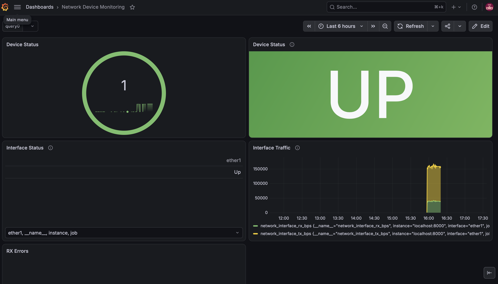
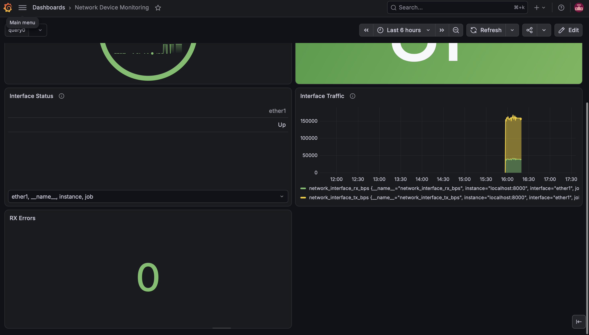

# NETE — Network Automation & Monitoring

NETE is a **working LAB prototype and engineering portfolio project** for investigating network incidents with Python, Streamlit and MikroTik RouterOS. It combines controlled SSH diagnostics, manual email triage, synthetic site matching, local case management, evidence exports and editable response drafts. A separate exporter supplies Prometheus metrics for Grafana.

NETE addresses a practical NOC workflow: turn a reported symptom into a reviewed investigation, collect device evidence, keep an incident record and prepare a response that says only what the evidence supports. It is not a deployed enterprise incident platform, a production monitoring service or a certified security product.

## Features

- Two existing workspaces: **Network Diagnosis** and **Email Proactiveness**.
- Read-only RouterOS identity, interfaces, traffic counters, error/drop counters, addresses and route evidence.
- Incremental ICMP results, verified packet counts and RTT summaries, with existing early-stop behavior.
- ARP/neighbor candidate discovery in Network Diagnosis; inventory-confirmed targets in Email Proactiveness.
- Rule-based email classification, including 10-ping outage/restoration investigations and 100-ping degraded/intermittent investigations.
- Conservative matching against a 600-record synthetic inventory, with explicit site confirmation.
- SQLite cases, lifecycle status, saved diagnostics, editable reply drafts and confirmed LAB-case deletion.
- Transcript/JSON evidence downloads and reply-draft downloads.
- Offline simulation for Network Diagnosis without SSH or network probes.
- Separate Prometheus exporter, scrape configuration, alert rules and example Grafana screenshots.

## Architecture and files

```text
Streamlit app.py
├── Network Diagnosis ──────────────────┐
└── Email Proactiveness                 │
    ├── noc_email / classification      │
    ├── synthetic site_inventory        │
    ├── explicit site confirmation ─────┤
    ├── CaseStore → local SQLite        │
    └── assessment and reply drafts     │
                                        ▼
                            diagnostics_service
                            → Netmiko / SSH → authorized LAB CHR
                            → read-only evidence and bounded pings
                                        │
                            diagnostic_report_ui / exports

Separate monitoring process:
exporter.py → SSH read-only interface metrics → /metrics
            → Prometheus + alert_rules.yml → Grafana
```

| File | Responsibility |
|---|---|
| `app.py` | Workspace selection, Network Diagnosis forms, live progress and simulation |
| `email_proactiveness.py` | Triage, confirmed LAB workflow, saved-case queue and draft editing |
| `noc_email.py`, `email_assessment.py` | Email extraction and evidence-limited interpretation/response templates |
| `email_cases.py` | Versioned SQLite storage and exact-ID confirmed LAB deletion |
| `site_inventory.py` | Google Sheets/local workbook loading, cache and site matching |
| `diagnostics_service.py`, `network_ssh.py`, `ping_diagnostics.py` | SSH collection, discovery and streamed ping parsing |
| `diagnostic_report_ui.py`, `report_formatting.py` | Shared evidence display, transcript and recommendations |
| `simulation.py` | Deterministic offline fixtures |
| `exporter.py` | Independent Prometheus exporter |
| `monitor.py`, `devices.py` | Earlier standalone one-shot ping report and sample addresses |
| `prometheus.yml`, `alert_rules.yml` | Prometheus scrape and device/interface-down rules |
| `test_*.py` | Automated tests using mocks, fixture evidence and temporary databases |

The flat module structure is intentional and retained. The Streamlit incident store and Prometheus exporter are separate; metrics do not automatically open cases or populate the email workspace.

## Technology and installation

The audited local environment uses Python **3.13.15**, Streamlit **1.66.1**, Netmiko **4.8.0**, Paramiko **5.1.0**, OpenPyXL **3.1.5**, Prometheus client **0.26.0** and python-dotenv **1.2.4**. The test runner is pytest **9.2.0**. These are observed versions, not a locked or independently certified dependency set.

```sh
python3.13 -m venv .venv
source .venv/bin/activate
python -m pip install -r requirements.txt
python -m pip install pytest
python -m streamlit run app.py --server.address 127.0.0.1
```

Use the resulting localhost URL. Offline simulation does not require RouterOS. Live diagnostics require an isolated, explicitly authorized LAB and a dedicated account with only the permissions needed for the existing read and ping commands.

Prometheus, Grafana and MikroTik CHR are external services. Docker can host monitoring services, but this repository does not supply a Dockerfile or Compose deployment. No Grafana provisioning, Telegram token or portable contact-point configuration is included.

## Configuration

**Streamlit and the CLI:** enter current SSH credentials in the UI or interactive prompts. They do not load router credentials from `.env`. Network Diagnosis has **Clear Credentials**; Email Proactiveness keeps its credentials in the browser session. Close the session when finished. Do not enter production credentials.

**Exporter:** copy `.env.example` to the ignored `.env`, then edit it privately. Only the exporter loads `.env` automatically; environment variables take precedence. Safe examples:

```dotenv
ROUTER_HOST=192.0.2.10
ROUTER_USERNAME=monitoring-user
ROUTER_PASSWORD=replace-with-a-new-secret
METRICS_PORT=8000
POLL_INTERVAL_SECONDS=10
LOG_LEVEL=INFO
```

Documentation addresses such as `192.0.2.10` are placeholders, not reachable demo targets. Do not copy a password into source code, screenshots, terminal history or Git.

| Optional variable | Purpose |
|---|---|
| `FIELDBASE_CASE_DB` | Local case database path; defaults to `email_cases.sqlite3` beside the app |
| `FIELDBASE_L2_SUPPORT_EMAIL` | Optional address used to compare pasted recipient headers |
| `FIELDBASE_INVENTORY_SHEET_ID` | Public synthetic Google Sheet fixture ID; never configure a customer inventory |

Inventory loading tries the configured synthetic Google Sheet, caches it for ten minutes and falls back to `FieldBase_Simulated_NOC_Inventory_600.xlsx` if unavailable. The sheet is read, not updated. Workbook labels and synthetic flags are application metadata, not proof of network isolation or ownership. Contact fields are demo data; verify fixture publication rights before distributing a modified inventory.

## Network Diagnosis workflow

1. Choose **Network Diagnosis** and **Live router**.
2. Enter an authorized management IP, username and password. Optionally enter a gateway and bank-router target. Select 5, 10, 20 or 100 packets; the initial default is 20.
3. Click **Run read-only checks**. The app collects identity, interfaces, traffic/counters, addresses, routes and ARP/neighbor observations.
4. If no target was supplied, the existing discovery logic prioritizes candidates and tests the first one. Discovered candidates are explicitly unverified; a reply does not establish device identity.
5. Use **Test Selected Candidate** or **Ping Custom IP** for a separate requested attempt. These use current session credentials. Failed or invalid attempts clear the previous displayed report.
6. Review the collected evidence and export a transcript or JSON report if needed.

The live workspace accepts operator-entered addresses and can probe discovered candidates. It has no production-network allowlist or independent authorization service. Only use it on a LAB whose addressing and routing you control.

Ping is sent through the router's SSH channel. The existing parser stops after **two confirmed lost packets** or a reply **above 99 ms**, and records the observed counts and stop reason. A 100-ping recommendation is an upper limit; early stopping can produce fewer packets. SSH errors, incomplete output and unverified channel state are not converted into ordinary packet loss. A ping reply establishes ICMP reachability during the check, not application availability, restoration or sustained performance.

For a disconnected demonstration, choose **Offline simulation**, select a scenario and click **Run simulation**. Simulation evidence is visibly marked and never opens SSH.

## Email Proactiveness workflow

1. Choose **Email Proactiveness** and paste a synthetic escalation email. Optional recipient headers and the configured L2 address are informational; they do not gate current triage.
2. Click **Scan email**. Every click reclassifies the current input and resets prior site confirmation and displayed investigation state, even for identical text. Scanning does not initiate SSH or overwrite saved cases.
3. Review the issue, supporting phrases, extracted site identifiers and proposed plan. Link-down/restoration requests normally select 10 pings; degraded, slow, intermittent/fluctuating, loss and optimization requests select 100. Resolved, conflicting or unsupported reports can require manual review instead.
4. Review possible synthetic inventory matches. Select the correct record when matches are ambiguous, then click **Confirm this site**.
5. Confirmation can create a case and automatically run the approved checks when current credentials and an approved packet count are available. Credentials missing at confirmation leave the case waiting. A later rerun with credentials can start that already-confirmed waiting case; scanning clears this authorization.
6. Inspect the diagnostic evidence, conservative assessment and reply draft. Drafts are editable, saved only through **Save draft to case**, and never emailed by NETE.

Email diagnostics require a synthetic record marked `LAB` and `YES` for diagnostics, with these existing exact targets:

| Role | Approved virtual LAB address |
|---|---|
| Management CHR | `192.168.128.2` |
| Host-side endpoint | `192.168.128.254` |
| Bank-router CHR | `192.168.128.3` |

The host-side endpoint is not established as an internet gateway. Email diagnostics disable ARP/neighbor discovery. Inventory approval does not prove that a similarly numbered host on another network is safe; independently isolate the virtual network before use.

## Cases, evidence and drafts

The saved queue preserves the email body/headers, classification evidence, affected sites, confirmed inventory, diagnostic status, report and explicitly saved draft. Workflow states are **New**, **Investigating**, **Awaiting Contact**, **Ready for Review** and **Resolved**.

Completed cases are historical evidence, not new tests. A fresh scan creates a separate investigation on confirmation, while ordinary reruns in that investigation reuse its case. Failed/interrupted cases without a completed report can be retried through the existing review checkbox and **Retry LAB diagnostics** button. Corrected credentials are read for that attempt.

For a saved synthetic LAB case, **Delete Case** opens a case-specific warning. Nothing is removed until **Confirm Delete Case** is clicked. **Cancel deletion** keeps the case. Deletion targets only that exact SQLite case row, including its report and saved draft; other case rows and tables are left alone. Back up the database before deleting demo evidence you need to retain.

SQLite is local and unencrypted. Structured credential fields are rejected by the case store; connection credentials are not added to normal report exports. Free-text emails, drafts and raw device output can still contain information an operator pasted or a router returned. Review every export before sharing and do not put secrets into incident text.

## Separate monitoring component

Run the exporter only when an authorized LAB and private `.env` are ready:

```sh
python exporter.py
```

It polls each running interface and serves Prometheus metrics on `METRICS_PORT` (default 8000), every `POLL_INTERVAL_SECONDS` (default 10 seconds). The server has no application authentication/TLS and uses the library's default listen address. Restrict it with local network/firewall controls; do not expose it publicly.

| Metric | Meaning |
|---|---|
| `network_device_up` | SSH collection connection state |
| `network_interface_up{interface="…"}` | RouterOS running flag |
| `network_interfaces_up` | Running-interface count |
| `network_interface_rx_bps{interface="…"}` | Received bits/second |
| `network_interface_tx_bps{interface="…"}` | Transmitted bits/second |

`prometheus.yml` points to `localhost:8000`. Inside a container, localhost is that container: configure the correct authorized exporter address for your environment. Grafana needs its own Prometheus data source and dashboard. The included rules cover device-down and interface-down alerts; alert delivery requires separately configured notification routing. Telegram notifications are optional external Grafana configuration, not a NETE feature verified by automated tests.

Earlier Grafana screenshots are included below. They are illustrative historical evidence, not proof of a currently running monitoring stack. The displayed RX Errors panel is not backed by the current exporter's metric set and must not be described as a verified zero.





The older `monitor.py` runs a one-shot ping report using `devices.py`. Its sample targets are documentation/loopback addresses. Its parser assumes a successful common macOS/Linux ping format and can fail on unreachable-device output; it is separate from the tested Streamlit diagnostic path.

## LAB demonstration

For a no-device demo, use Network Diagnosis offline simulation and synthetic emails for triage. Site confirmation with credentials is a live action, so do not confirm a site merely to show triage.

For an isolated CHR demo, verify the three virtual LAB addresses above, routing isolation and dedicated account privileges yourself. Use synthetic text such as `Subject: SIM-WEM-001\n\nThe link is down.` and then `The link is intermittent.` to show the 10/100 recommendations. After reviewing the inventory, confirmation may initiate SSH. Show authentication failure with a deliberately incorrect demo password, then use explicit retry with corrected LAB credentials, or scan again and confirm a fresh investigation. Use a disposable LAB case to demonstrate cancellation and confirmed deletion.

No real router or customer connection is required for the automated tests. A successful mocked connection is not a live-device acceptance test.

## Testing

```sh
source .venv/bin/activate
python -m pytest -q
```

Tests cover classification, inventory matching, command collection, streamed ping evidence/early stops, incomplete output, saved cases, fresh rescans, authentication/timeout handling, corrected-credential retry, response drafting, confirmed deletion, duplicate download IDs and credential-bearing exception handling. They use simulated responses, patched SSH connections and temporary SQLite stores; do not substitute real credentials or customer targets.

The release audit records actual test counts and results separately. Dependency ranges are intentionally retained; a clean environment may resolve different versions. Perform dependency advisory review before deployment or publication after dependency changes.

## Security considerations and release gate

- Never publish credentials or secret-bearing Git history. The v1.0.0 release uses the verified clean public ancestry and a sanitized snapshot; three later local commits containing a LAB credential are excluded. The published commits checked did not contain that credential, so this release does not require changing the existing LAB password. If a credential is exposed publicly or elsewhere, rotate it and assess history remediation. See [GitHub's sensitive-data guidance](https://docs.github.com/en/authentication/keeping-your-account-and-data-secure/removing-sensitive-data-from-a-repository).
- SSH calls use Netmiko password authentication; key/agent authentication is disabled by default. Incorrect credentials are not replaced by a cached successful report.
- SSH host-key verification is **not enforced** in this prototype (`ssh_strict=False`, no known-hosts loading). This permits server impersonation on an untrusted network. Use an isolated trusted LAB; add verified host-key enrollment before deployment. See [Netmiko connection options](https://ktbyers.github.io/netmiko/docs/netmiko/base_connection.html).
- Router commands read state, print counters, monitor traffic once or send bounded ICMP probes. No router configuration commands are requested by NETE. Router permissions remain the final enforcement boundary.
- Current connection credentials are redacted from persisted email diagnostic errors, and exporter errors do not log raw exception tracebacks. Keep SSH-library debug logging disabled; arbitrary device text and free text are not universally scrubbed.
- The app has no user authentication, per-user case ownership, RBAC, tamper-evident audit log or database encryption. Anyone with app access can see the shared case store. Confirmation is a UI safety step, not access control.
- `.gitignore` excludes local credentials, SQLite stores, virtual environments, backups, snapshots and common export folders. An ignore rule cannot protect files already committed or secrets pasted into ordinary source/documents.
- The inventory source is a public synthetic fixture. Never configure production/customer records in it or assume synthetic metadata guarantees provenance.
- Do not publish local `.env`, case databases, raw reports, backups or historical secret-bearing snapshots. Keep private recovery archives outside the repository.

## Known limitations and future work

This release candidate is a LAB prototype. There is no claim of formal compliance, production readiness, customer deployment, proven performance gains or operational alert delivery.

Known limitations include heuristic email classification, no OCR, manual review of ambiguous sites, raw evidence that may contain identifying network information, no independent inventory provenance verification, no network allowlist in Network Diagnosis, no multi-user isolation, in-memory session credentials, unencrypted SQLite, unpinned transitive dependencies, no supplied Docker/Grafana deployment, and no application-service or sustained-latency baseline verification. Exporter polling is sequential; disappearing interface labels can persist until restart. Unexpected exporter errors can leave older metrics visible, and traffic-query failure does not reset old traffic values.

Future work should prioritize verified SSH host keys, explicit deployment authorization controls, authentication and case ownership, evidence redaction/encryption, reliable exporter metric freshness, dependency/CI security checks, reproducible deployment configuration and documented service baselines. These are future improvements, not features claimed for v1.0.0.

See [release notes](RELEASE_NOTES.md) for the v1.0.0 LAB prototype scope and verification results.
